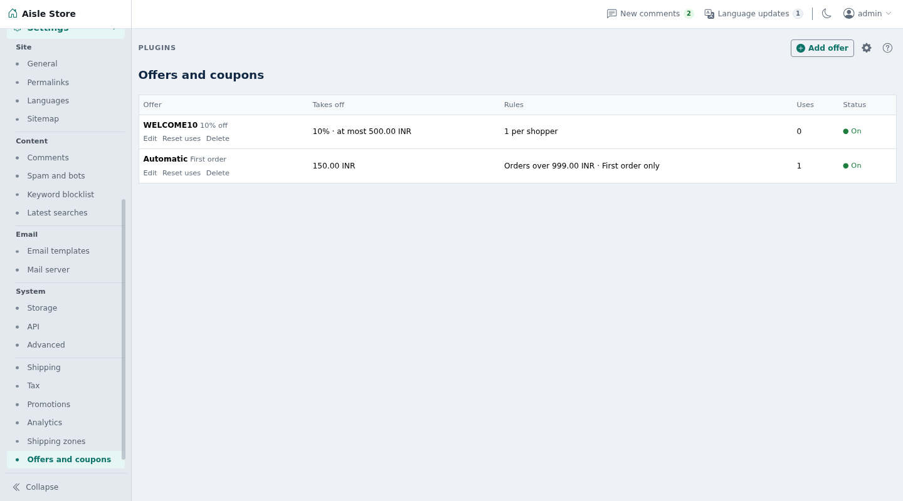

# Promotions

Coupon codes, automatic discounts, a first-order offer and usage limits for Shopclass shop orders.

## Requirements

- Shopclass 7.1.0 or later, in shop mode
- PHP 8.2 or later
- No outside accounts. No cron, worker, Redis or shell needed.

## Install

1. Open **Plugins → Browse** (or upload the zip from the GitHub release).
2. Install.
3. Activate.

## Set up

1. Open **Billing → Offers and coupons** and press **Add offer**.
2. Fill **Code** (leave empty for an automatic offer), **Name at checkout** and **Offer is on**.
3. Under **Discount**, pick what **Takes off**: a percentage of the items, a fixed amount, or the delivery charge. Enter **How much**. **Most it takes off** sets a cap.
4. Under **Rules**, set any of **Minimum order**, **Starts**, **Ends**, **Uses in all**, **Uses per shopper** and **Only for a shopper's first order**.
5. Press **Save offer**.
6. Optional: the **Settings** tab on the same screen holds **First-order banner**, a line themes can show.

Amounts are in the site's currency. An offer only serves carts in the currency it was saved in.

## How it works

- With a code, the offer applies when the shopper types the code at checkout. Codes are letters, digits and dashes (up to 40). Capitals and spaces do not matter. A second code replaces the first.
- Without a code, the offer applies to every cart that meets its rules. Automatic offers add up with each other and with the code.
- All discounts together never take off more than the items and delivery cost.
- A per-shopper limit or first-order rule needs a signed-in shopper.
- A first order is one placed while the shopper has no other order pending, paid, shipped or delivered.
- A refused code shows under the code field and blocks the order. Codes: `coupon_invalid`, `coupon_not_started`, `coupon_expired`, `coupon_min`, `coupon_used`, `coupon_sign_in`, `coupon_first_order`.
- The browser sends only the code. Amounts are worked out on the server.
- A use is counted when an order is placed, in one database statement per counter, so two orders cannot take the last use. A cancelled, failed or refunded order gives the use back.
- **Reset uses** on the offers list restarts the count from 0 for every shopper.

## Notes / limits

- At most 200 offers.
- Orders keep the discount they were given. Deleting an offer does not change them.
- Without the cart hooks (older Shopclass), the plugin loads, does nothing and says so in the admin.
- Offers and the banner are preferences in the `promotions` section. Use counters are rows in core's `t_key_value` table. No table of its own.
- Uninstalling removes the offers, settings and usage counts.

## For developers

`promotions_banner()` returns the first-order banner text while an automatic first-order offer is on, else an empty string. Escape it when printing.

Listens to the filters `cart_discount_lines` and `cart_problems`, and the actions `cart_checkout_before`, `billing_order_placed`, `billing_order_cancelled`, `billing_order_failed` and `billing_order_refunded`. It fires no hooks.

Translations: copy `languages/promotions.pot` to `languages/<locale>/messages.po`, translate, and compile to `messages.mo`. Rebuild the template with `php tools/make-pot.php`.

Tests: `./tests/run.sh` (unit) and `php tests/integration/checkout.php` (needs core's scratch MySQL on port 33061).

## Support

[GitHub issues](https://github.com/mindstellar/shopclass-plugin-promotions/issues)

## License

GPL-3.0-or-later. See [LICENSE](LICENSE).
